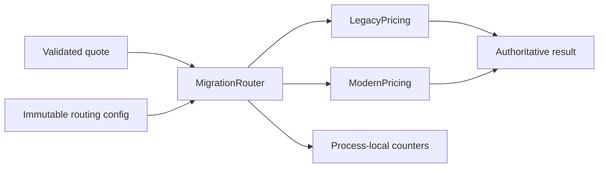

# Java Modernization Playbook

[](https://github.com/sameerkhanp119-dot/java-modernization-playbook/actions/workflows/ci.yml)

An executable strangler migration of a small Java pricing component: characterize the legacy behavior, extract a compatible replacement, compare it in shadow mode, route a stable canary cohort and roll back.

**[Explore the interactive migration lab](https://sameerkhanpathan.com/demos/modernization/)** · [Migration plan](docs/migration-plan.md) · [Tests](src/test/java/dev/skp/modernize/MigrationTest.java)

This is an independent, synthetic reference project. It is not a reconstruction of employer code or a claim about a completed production migration.

## The interesting compatibility rule

A member gets 7.5% off baskets of at least $100, capped at $30. Free shipping is based on the **discounted** subtotal. A $150 member basket therefore does not get free shipping. That behavior is intentionally preserved during the structural migration; changing it is a separate business decision.

Amounts use `BigDecimal`, a defined two-decimal input boundary and explicit half-up rounding. Known boundary cases are asserted independently; a seeded 10,000-request comparison broadens the compatibility check but does not prove equivalence for every possible input.

## Run

Requires Java 17+ and Maven 3.6.3+.

```sh
mvn verify
java -jar target/java-modernization-playbook-1.0.0.jar
```

The demo prints SHADOW, CANARY, MODERN and ROLLBACK outcomes, followed by local counters. No external service, database or cloud account is required. The runnable application has no runtime dependencies beyond Java; JUnit is used for tests.

The browser lab is a separate JavaScript simulation of the same rules. Serve `demo/` with any static HTTP server, for example `python -m http.server 8088 --directory demo`, then open `http://localhost:8088`. Its output is illustrative, not a Java backend response.

## What is implemented

- Legacy and extracted pricing adapters behind one canonical contract.
- Read-only SHADOW comparison that preserves the legacy response on mismatch or candidate failure.
- Stable SHA-256 routing buckets for CANARY mode.
- Atomic configuration replacement for subsequent requests.
- Read-only fallback on candidate exceptions; separate comparison, mismatch, failure and fallback counters.
- Characterization, invalid-input, deterministic compatibility, injected-failure, routing, rollback and parallel-request tests.
- A migration plan covering promotion evidence, distributed-system limits and additive database migration principles.

## Inspect the seam



| File | Purpose |
|---|---|
| `Quote.java` | Validated canonical request and response contract |
| `LegacyPricing.java` | Baseline behavior to characterize |
| `ModernPricing.java` | Extracted policies preserving that behavior |
| `MigrationRouter.java` | Routing, comparison, fallback and counters |
| `MigrationTest.java` | Business boundaries and migration safety checks |
| `docs/migration-plan.md` | Rollout stages, rollback drill and scope |

## Boundaries

Both implementations run in the same JVM. No distributed feature flag service, HTTP timeout, durable telemetry, database backfill or production canary deployment is implemented. Shadow evaluation is synchronous and could add latency. Fallback is appropriate for this read-only calculation; it cannot safely be generalized to writes. LEGACY rollback affects subsequent calls and does not reverse completed side effects or destructive database changes.

Independent portfolio project by [Sameer Khan Pathan](https://sameerkhanpathan.com). MIT licensed.
